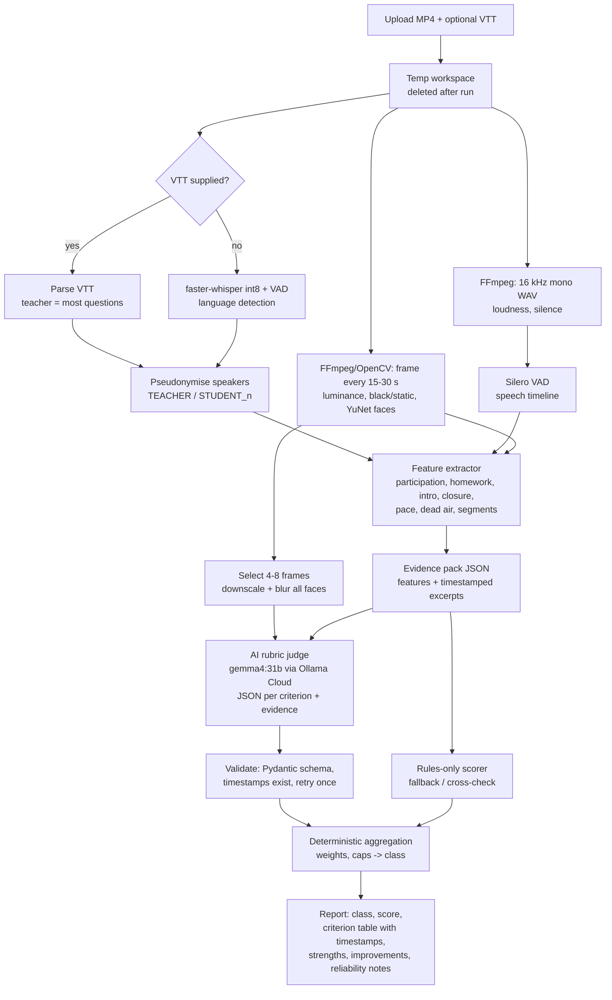

# Recommended architecture

**Recommendation:** a **hybrid pipeline (local feature extraction + AI rubric judge + deterministic aggregation)**, with a **rules-only fallback** that runs fully offline. Built with Python 3.12, FFmpeg, OpenCV, faster-whisper (Silero VAD built in), Gradio, and one Ollama Cloud text+vision model (`gemma4:31b` first choice), **subject to organiser permission**.

Why this and not something simpler or fancier:

- **Rules alone** miss tone and rapport. On this dataset they also can't separate the Poor recordings from the Average ones: Poor teachers addressed students and asked questions, but feedback faulted their camera, background and tone.
- **Free-form AI** gives generic, unstable verdicts.
- **A trained classifier** is not defensible with 10 labelled samples.
- **Direct video understanding** isn't offered by any Ollama Cloud model, so extract-first is the only option anyway.
- The organiser's feedback gives an **explicit rubric**. Scoring each rubric criterion with cited evidence, then aggregating deterministically, is the most transparent design that still uses AI where AI helps.

## 1. Pipeline

## 2. Rubric (derived from the organiser's feedback themes)

Provisional weights. These **must be frozen before evaluation** (see `approach_comparison.md`). Each criterion is rated 0 (absent/poor), 1 (partial) or 2 (clearly present), with required evidence.

| # | Criterion | Weight | Primary evidence | Who judges |
|---|---|---|---|---|
| 1 | Opening and rapport (greeting, warm-up, new joiners invited to introduce themselves) | 15 | First 5–8 min of transcript; student turns before lesson content | AI, with rule-based counts supplied |
| 2 | Inclusion and individual engagement (everyone called on, student talk share) | 20 | Student share of turns/time, distinct students who spoke, questions directed at individuals | Rules give numbers; AI judges quality |
| 3 | Tone and energy (pleasant, encouraging, enthusiastic) | 15 | Transcript excerpts (praise, encouragement, exclamations), speech pace, pitch variability (optional) | AI |
| 4 | Lesson structure and closure (clear flow, recap, proper conclusion) | 10 | Segment timeline, last 5–8 min of transcript | AI |
| 5 | Homework assigned | 10 | Keyword hits with timestamps (validated against feedback on all checkable samples) | Rules (AI confirms context) |
| 6 | Teacher presence on camera (camera on, face visible, adequate light) | 15 | Fraction of sampled frames with a face / not black; luminance; long camera-off stretches | Rules (local) |
| 7 | Professional setup (branded 8x8 background) | 5 | 4–8 face-blurred frames | AI vision (only if frames are permitted), else "not assessed" |
| 8 | Technical quality (audio clarity, dead air not explained by activities, frozen video) | 10 | Loudness, silence timeline, static-frame ratio | Rules, with AI deciding whether silence is explained (e.g. puzzle time) |

**Aggregation:** score = Σ weight × rating / 2, giving 0–100. Provisional bands: **Excellent ≥ 80, Good 65–79, Average 50–64, Poor < 50**.

**Hard caps**, reflecting how reviewers wrote the feedback: teacher not visible for > 30% of the class caps the result at *Average*; severe AV problems for > 20% of the class cap it at *Average*.

**Criteria the system can't assess** (e.g. frames not permitted, transcript language mismatch) are reported as "not assessed". They are excluded from the denominator rather than scored 0, and the report says so.

## 3. Output (what the user sees)

- Class (Poor/Average/Good/Excellent), 0–100 score, and a confidence/reliability note.
- A per-criterion table: rating, 1–2 sentence explanation, and **timestamps** (e.g. "12:40 – teacher asks STUDENT_3 to explain the move").
- Top 3 strengths and top 3 concrete improvements, phrased like the organiser's feedback.
- A "measured facts" panel: duration, speech ratio, student talk share, homework mentions, camera-visible %, longest silence, and so on.
- Reliability flags: no VTT supplied (ASR used), detected language, face-detector confidence, cloud judge unavailable (rules-only mode).
- **No raw frames are shown or stored.** Real names never appear; only pseudonyms.

## 4. Privacy and data handling

| Data | Leaves the machine/server? |
|---|---|
| MP4, WAV, full-resolution frames | **Never** |
| Real names (from the VTT) | **Never**: replaced by pseudonyms before any further processing |
| Pseudonymised transcript excerpts + numeric features | Only to Ollama Cloud, **only if the organiser permits** |
| 4–8 downscaled, face-blurred frames | Only if the organiser **explicitly** permits images; otherwise criterion 7 is "not assessed" |

- Uploads go to a temp directory that is deleted after processing; nothing is logged except aggregate timings.
- `.gitignore` already excludes `dataset/`, all media/transcripts and `feedbacks.pdf`. The repo must contain no sample outputs derived from recordings.
- The Ollama API key is read from an environment variable or hosting secret, never committed.

## 5. Hosting and latency

- Host: Hugging Face Spaces (Gradio) or Streamlit Community Cloud. Free-tier CPU/RAM and upload limits are **unverified** and must be checked first.
- **Bottleneck: ASR when no VTT is supplied.** faster-whisper's official benchmark (small, int8, 8 threads) is ~1 m 42 s per 13 min of audio, which extrapolates to ~6–7 min per 50-min class on 8 threads and much longer on 2 vCPUs. Options, in order:
  1. Use the VTT if the tester provides one.
  2. `base` int8 (faster, less accurate) on the full audio.
  3. Windowed transcription: first 10 min, last 8 min, and several mid-class windows, with this coverage reported in the output.
- Pick the option after measuring on the actual host. Show progress in the UI.

## 6. Build plan (fits the 4–5 h budget)

| Step | Time | Done when |
|---|---|---|
| 0. Confirm open questions with organiser (below) | — | Answer received, or default to rules-only + local |
| 1. Project skeleton, venv (Py 3.12), requirements | 15 min | `pip install` works |
| 2. Feature extractor (audio, frames, VTT parse, pseudonymise, rule features) | 75 min | Evidence pack JSON for all 12 recordings, cached locally |
| 3. Rules-only scorer + report | 30 min | Offline end-to-end result |
| 4. ASR path (faster-whisper) for MP4-only input | 30 min | Same evidence pack without VTT |
| 5. AI rubric judge + validation + aggregation | 45 min | Valid JSON for all recordings |
| 6. Evaluation run (blinded, frozen rubric; matrix in `approach_comparison.md`) | 30–45 min | Metrics table + criterion agreement |
| 7. Gradio UI + deploy + README + 300-word explanation | 45 min | Hosted link works on a demo file |

## 7. Open questions for the organiser (blocking items first)

1. **Is Ollama Cloud a permitted service** for (a) pseudonymised transcript text and numeric features, and (b) downscaled, face-blurred frames?
2. Will the test recording come with a Zoom `.vtt` transcript, or only the MP4?
3. Is the expected class mapping *Weak → Poor* and *Known quality issues → Poor* correct?
4. Can test recordings be in Malayalam or another non-English language?
5. Any hosting restrictions (e.g. the app must not be publicly listed)?

## 8. Known limitations (to state honestly in the submission)

- Validation rests on 10 labelled recordings; any accuracy figure has a very wide uncertainty.
- Visual criteria depend on the (unverified) Zoom layout. The local face detector must be validated, since Haar already failed.
- Non-English or code-mixed classes reduce reliability of every transcript-based criterion.
- The rubric reflects one reviewer's written comments; other reviewers may weigh things differently.
